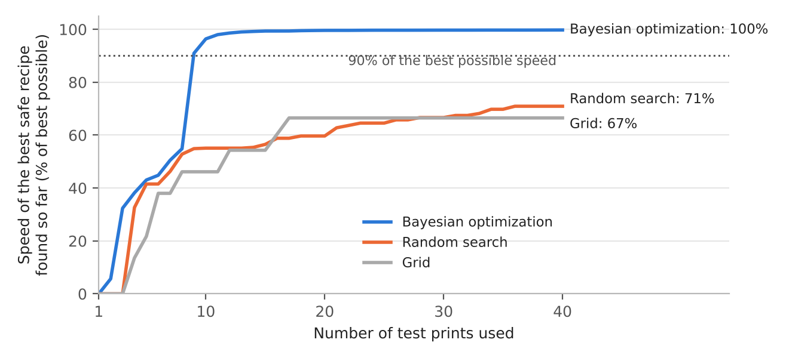
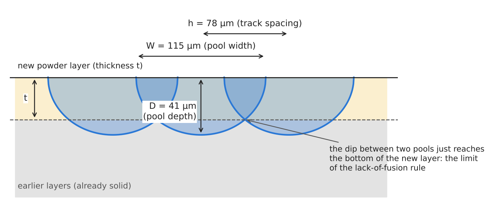
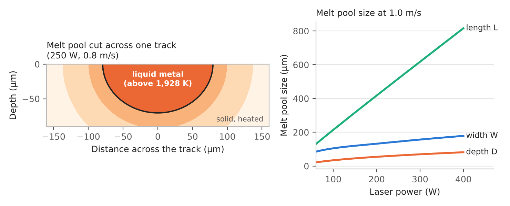
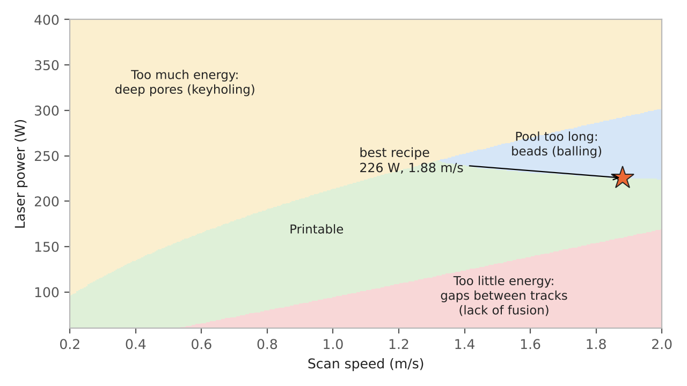
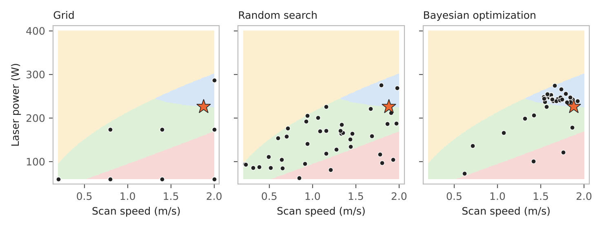
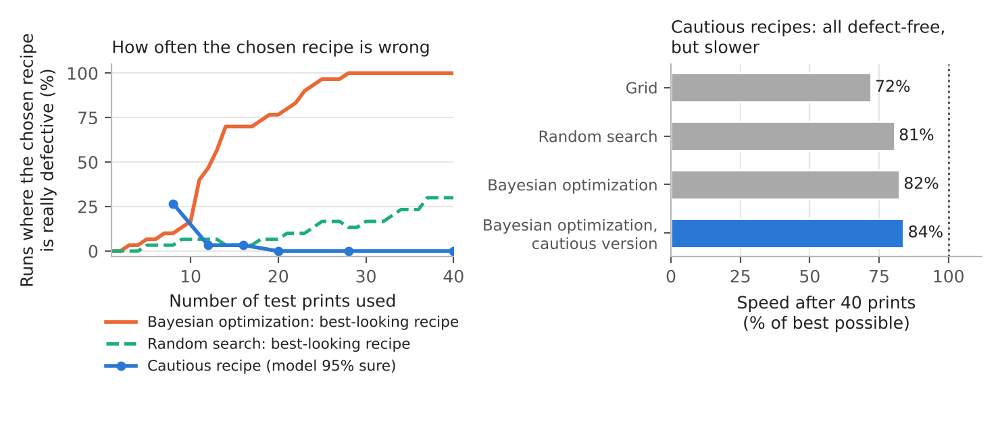

# Finding Fast, Defect-Free Settings for Metal 3D Printing with Few Test Prints

**A simulation study of Bayesian optimization for laser powder bed fusion (LPBF)** · Python · 2026

In metal 3D printing, the wrong laser settings leave gaps or pores in the part. Finding the **fastest settings that still give a sound part** usually takes many slow, expensive test prints. This project uses a computer model of the printing process for a titanium alloy (Ti-6Al-4V) to ask: **how few test prints are really needed, and which way of choosing them works best?**

Three ways of choosing test prints were compared, each allowed **40 prints** and each repeated **30 times**:
- an evenly spaced **grid**,
- **random** choices,
- **Bayesian optimization**, which uses earlier results to pick the next print.

**Main results**

- **Using earlier results pays off.** With exact measurements, Bayesian optimization reached **90% of the best possible speed in about 9 prints**. The grid and random search were still below **72% after 40**.
- **A small measurement error can mislead the search.** With a **3%** error, the recipe that *looked* best was **really defective in all 30 runs** after 40 prints.
- **Being cautious fixes it.** Choosing the fastest recipe the model is **95% sure** about gave **defect-free recipes in every run**, at the cost of about **16%** of the speed.
- **The best recipe sits right on the edge** of two defect rules. That is why it is both fast and easy to get wrong.




---

## Contents

1. [The problem](#1-the-problem)
2. [The settings and the goal](#2-the-settings-and-the-goal)
3. [A virtual printer](#3-a-virtual-printer)
4. [The three defect rules and the best recipe](#4-the-three-defect-rules-and-the-best-recipe)
5. [What was tested](#5-what-was-tested)
6. [Results](#6-results)
7. [Checking the numbers by hand](#7-checking-the-numbers-by-hand)
8. [What it means](#8-what-it-means)
9. [Limitations](#9-limitations)
10. [Running the code](#10-running-the-code)
11. [Repository layout](#11-repository-layout)
12. [References](#12-references)

---

## 1. The problem

How **laser powder bed fusion (LPBF)** works:
1. A thin layer of metal powder is spread over a plate.
2. A laser melts the powder along a path. The melted metal forms a small liquid **melt pool**, which moves with the laser and hardens behind it.
3. The plate moves down, a new layer is spread, and the process repeats, so the part is built layer by layer.

It is used for strong, light parts, such as those for aircraft and medical implants.

Printing faster saves time and money, but the wrong settings cause three common defects:

- **Lack of fusion:** too little energy leaves gaps between tracks [3].
- **Keyholing:** too much energy drills a deep, narrow hole that traps gas pores [4].
- **Balling:** a pool that is too long and thin breaks into beads, like a thin stream of water breaking into drops [5].

To find good settings, engineers print small samples, cut them open and measure the melt pools. Every test is slow and costly, and every measurement has some error. The study asks four questions:

1. What are the fastest settings that avoid all three defects?
2. How many test prints does each way of choosing them need?
3. What happens when the measurements have a 3% error?
4. How can the final choice be made safer?

## 2. The settings and the goal

| Setting | Range tested |
|---|---|
| Laser power | 60 to 400 W |
| Scan speed | 0.2 to 2.0 m/s |
| Hatch spacing (distance between neighbouring tracks) | 40 to 160 µm |
| Layer thickness | 30 µm (fixed) |

The goal is to print as fast as possible, measured as the **build rate**:

> build rate = scan speed × hatch spacing × layer thickness (mm³ of metal per second)

The cut below shows three neighbouring tracks at the best recipe found. It labels the four sizes that decide whether a part is sound:



## 3. A virtual printer

No printer was available, so a heat-flow formula stands in for one.

**How the formula works.** The model treats the laser as a moving spot of heat on a block of titanium alloy. The temperature at any point is found by adding up the heat that has arrived from every earlier position of the laser. This is the classic formula of Eagar and Tsai (1983) [1]; a simpler version for a single point of heat was published by Rosenthal (1946) [2]. The code adds up the effect step by step.

**From temperature to melt pool size.** Wherever the temperature is above the melting point (**1,928 K**), the metal is liquid. The size of that region gives the melt pool's **width W**, **depth D** and **length L**.



The right-hand chart shows why balling matters at high power: as power rises, the pool gets **much longer** but only a little wider and deeper.

**Material values used:**

| Item | Value | Basis |
|---|---|---|
| Density | 4,420 kg/m³ | Typical value for Ti-6Al-4V [9] |
| Specific heat | 700 J/(kg K) | Typical value [9] |
| Thermal conductivity | 20 W/(m K) | Typical value [9] |
| Melting temperature | 1,928 K | Typical value [9] |
| Starting temperature | 300 K | Assumed (room temperature) |
| Share of laser power absorbed | 0.40 | Assumed |
| Laser spot radius | 50 µm | Assumed |

**A lookup table to save time.** The heat model was run once for **171 powers × 73 speeds**, and a smooth curve was drawn through the table. Each simulated "print" then takes a fraction of a second.

**Three checks on the virtual printer:**

| Check | Result |
|---|---|
| The code's step-by-step sum against a precise integration (65 points) | within **0.14%** |
| Shrinking the laser spot to a point, against Rosenthal's simple formula | within **0.003%** |
| The lookup table against the full calculation (25 random settings) | within **0.03%** |

## 4. The three defect rules and the best recipe

| Defect | What goes wrong | Rule for a safe recipe | Source |
|---|---|---|---|
| Lack of fusion | Gaps between tracks (too little energy) | (h ÷ W)² + (t ÷ D)² ≤ 1 | [3] |
| Keyholing | Deep, narrow hole traps gas pores (too much energy) | Keyhole number ≤ 6 | [4] |
| Balling | Long, thin pool breaks into beads | L ÷ W ≤ 3.85 | [5] |

- **Lack of fusion.** The rule compares the spacing with the pool's width, and the layer thickness with the pool's depth. If the sum of the squares is more than 1, gaps are left between tracks.
- **Keyholing.** The keyhole number depends only on power, speed and spot size, so it can be checked **before any print**. Every method screens out keyhole recipes first.
- **The widest safe spacing.** For any power and speed, the widest spacing that still avoids gaps is h = W × √(1 − (t ÷ D)²). Printing at that spacing is fastest, so the search is mainly about **power and speed**.

Only about **28%** of the power and speed combinations tested are printable:



**The best recipe**, found by checking 250,000 power and speed combinations at their best spacing:

| Item | Value | Rule or limit |
|---|---|---|
| Laser power | 225.6 W | |
| Scan speed | 1.881 m/s | |
| Hatch spacing | 78.35 µm | widest that avoids gaps |
| Melt pool width, depth, length | 115.3, 40.9, 443.7 µm | |
| Lack-of-fusion sum | 1.000 | limit 1 |
| Balling ratio L ÷ W | 3.847 | limit 3.85 |
| Keyhole number | 4.63 | limit 6 |
| **Build rate** | **4.42 mm³/s** | the goal |

The best recipe meets **two rules almost exactly at the same time**. This is natural, because printing faster means pushing the settings until a rule is just satisfied. But it also makes the best recipe easy to get wrong, as Section 6 shows.

## 5. What was tested

### 5.1 Measurement error

In a real lab, pool sizes are measured from cut and photographed samples, which has some error. The model adds a random error of about **3%** to each measured W, D and L. A version with **exact** measurements was also run, for comparison.

### 5.2 Three ways of choosing test prints (40 prints each)

- **Grid:** an evenly spaced set of 40 recipes, after removing those the keyhole rule already excludes.
- **Random search:** 40 random recipes that pass the keyhole rule.
- **Bayesian optimization** [6, 7] works in a loop:
  1. **Start** with 8 evenly spread recipes.
  2. **Predict.** A statistical model (a *Gaussian process*) predicts the pool size of every untried recipe, and also how unsure that prediction is.
  3. **Score** each untried recipe: (how much faster than the best safe recipe so far) × (chance it is free of defects).
  4. **Print** the highest-scoring recipe, add the result, and repeat until 40 prints are used.

> **Example.** The best safe recipe so far prints at 3.5 mm³/s. A new recipe is predicted at 4.0 mm³/s with a 69% chance of being defect-free, so its score is (4.0 − 3.5) × 0.69 = **0.35**.
>
> A recipe that is very fast but probably defective, or safe but slower than the best so far, scores close to zero.

**Two versions of Bayesian optimization** were tried:
- one predicts the **pool size** and applies the exact defect rules itself (shown below);
- one predicts the **safety margins** directly.

Their results were very similar (Section 6.1), and both are in the code.

### 5.3 Choosing the final recipe

After its prints, each method has to name one recipe. Two ways of choosing were tested:

- **Best-looking recipe:** the fastest recipe whose *measurement* looked free of defects.
- **Cautious recipe:** the fastest recipe that the model is at least **95% sure** is free of defects [8].

A **cautious version** of Bayesian optimization also uses the 95% idea while it searches: its "best so far" is the fastest recipe the model is 95% sure about, rather than the one whose measurement looked best.

### 5.4 How the methods were scored

- **Repeats:** each method was run **30 times**, with different random errors and starting points.
- **Score:** each answer was scored by the **true** speed of the chosen recipe ÷ the speed of the true best recipe (4.42 mm³/s). A recipe that is really defective **scores zero**.
- **Reported value:** the middle result of the 30 runs.

## 6. Results

### 6.1 With exact measurements

| Method | After 12 prints | After 20 prints | After 40 prints | Prints needed to reach 90% |
|---|---|---|---|---|
| Grid | 54% | 67% | 67% | not reached |
| Random search | 55% | 60% | 71% | not reached (1 run in 30) |
| **Bayesian optimization** | **99%** | **100%** | **100%** | **9** |
| Bayesian optimization (margin version) | 98% | 100% | 100% | 10 |

*Speed of the best safe recipe found so far, as a share of the best possible (middle result of 30 runs).*

- **Bayesian optimization** found a very good recipe (over 95% of the best speed) within about 10 prints.
- **The grid** has only a few levels of each setting.
- **Random search** needs luck to land in the narrow safe corner near the best recipe.

The figure at the top of this page shows the full curves.

### 6.2 Where each method puts its test prints



*One run with a 3% measurement error; the star is the true best recipe.*

- **Grid:** spread evenly. Many grid points share the same power and speed and differ only in spacing, so they overlap on the map.
- **Random search:** scattered across the map.
- **Bayesian optimization:** concentrates its prints **right on the edge** of the balling zone, next to the best recipe. That is exactly what makes it efficient, and also what makes it vulnerable to measurement error.

### 6.3 With a 3% measurement error

A natural guess is that a small 3% error should change little. It did not: the standard method's best-looking recipe was **really defective** in most runs.



**Why it happens.** Bayesian optimization keeps printing recipes on the edge of a defect rule. With a 3% error, some recipes that are really slightly defective **look safe by luck**. Choosing the best-looking one then tends to pick a lucky, defective recipe. This is sometimes called the **winner's curse**: the best of many noisy measurements is partly luck.

> **Example.** At the best recipe, a 3% error in W and D changes the lack-of-fusion sum by about ±0.043 (2 × 0.03 × √(0.4614² + 0.5386²) = 0.0426).
>
> A recipe that is really 3% over the limit (sum = 1.03) looks safe whenever the measured sum falls below 1, which happens about **24%** of the time.
>
> If 10 such recipes are printed, the chance that at least one looks safe is 1 − 0.76¹⁰ = **94%**.

**Runs (out of 30) where the chosen recipe is really defective:**

| Method | Best-looking recipe, after 12 / 20 / 40 prints | Cautious recipe, after 40 prints | Speed of the cautious recipe |
|---|---|---|---|
| Grid | 0% / 0% / 0% | 0% | 72% |
| Random search | 7% / 7% / 30% | 0% | 81% |
| Bayesian optimization | 47% / 77% / **100%** | 0% | 82% |
| Bayesian optimization (margin version) | 30% / 87% / **100%** | 0% | 84% |
| **Bayesian optimization, cautious version** | 17% / 23% / 47% | **0%** | **84%** |

- **Best-looking recipe:** risky for any method that concentrates its prints near the edge. The grid was never wrong only because it doesn't do this.
- **Cautious recipe:** removed the problem for every method. In all 30 runs it was free of defects.
- **The price of safety:** the cautious recipe reached about **84%** of the true best speed, so about **16%** of the speed is given up. To be 95% sure, a recipe must stay a little way inside the safe edge (about 1.6 times the typical measurement error), and that distance costs speed.
- **After 12 to 40 prints,** the cautious Bayesian optimization did significantly better than random search (Mann–Whitney test, p ≤ 0.004). The two versions of Bayesian optimization were not significantly different from each other.

## 7. Checking the numbers by hand

### 7.1 The heat formula at one point

**The point:** a laser of 200 W moving at 0.8 m/s, and a point 200 µm behind the laser and 40 µm to the side. The simple point-of-heat formula [2] gives its temperature:

> T = 300 + q ÷ (2π k R) × e^(−v(ξ + R) ÷ (2α))

**What the symbols mean:**
- **q** is the absorbed power;
- **k** is the conductivity;
- **R** is the distance from the laser;
- **v** is the speed;
- **ξ = −200 µm** is the distance along the scan direction (negative means behind the laser);
- **α** is the rate at which heat spreads.

| Quantity | Calculation | Result |
|---|---|---|
| Heat spreading rate α | 20 ÷ (4,420 × 700) | 6.464 × 10⁻⁶ m²/s |
| Distance R | √(200² + 40²) µm | 203.96 µm |
| Absorbed power q | 0.40 × 200 W | 80 W |
| First part | 80 ÷ (2π × 20 × 203.96 × 10⁻⁶) | 3,121.3 K |
| Exponent | −0.8 × (−200 + 203.96) × 10⁻⁶ ÷ (2 × 6.464 × 10⁻⁶) | −0.2451, so e^(−0.2451) = 0.7826 |
| **Temperature** | 300 + 3,121.3 × 0.7826 | **2,742.8 K** (code: 2,742.8) |

### 7.2 The best recipe

| Quantity | Calculation | Result |
|---|---|---|
| Widest spacing h | 115.33 × √(1 − (30 ÷ 40.88)²) = 115.33 × 0.6793 | 78.35 µm |
| Build rate | 1.881 m/s × 78.35 µm × 30 µm | 4.421 mm³/s |
| Lack-of-fusion sum | (78.35 ÷ 115.33)² + (30 ÷ 40.88)² = 0.4614 + 0.5386 | 1.0000 |
| Balling ratio | 443.70 ÷ 115.33 | 3.847 |
| Keyhole number | (0.4 × 225.57) ÷ (1,628 × π × 4,420 × 700 × 1.233 × 10⁻⁹) = 90.23 ÷ 19.51 | 4.63 |

## 8. What it means

1. **Using earlier results to choose the next test** is far more efficient than a fixed grid or random choices.
2. **When the best recipe sits on the edge of a rule, small measurement errors become dangerous.** How the final recipe is chosen matters as much as how the search is done. With measurement error, the cautious rule mattered more than which version of the search was used.
3. **Safety has a price**, here about 16% of the speed. A company could choose the confidence level (95% here) according to how costly a defect would be.

## 9. Limitations

- **A simple heat model.** It leaves out boiling, fluid flow and the change of material properties with temperature. Published tests show it over-predicts pool width and under-predicts depth [5], so the best recipe found here is **not a real recipe** for a real machine.
- **Single-track defect rules.** Their limits are not exact; other balling limits are used in the literature. Real parts can have other defects.
- **A simple error model.** It uses independent 3% errors. Real measurement errors can be larger and linked to each other.
- **Limited scope.** Only three settings were varied, and no real prints were made. The conclusions are about **how the search methods compare**, not about a validated process window.

## 10. Running the code

Requires Python 3.10 or newer.

```bash
pip install -r requirements.txt
export PYTHONPATH=.            # Windows PowerShell: $env:PYTHONPATH="."

python scripts/01_build_ground_truth.py   # run the heat model for 171 powers x 73 speeds (~4-10 min)
python scripts/02_validate_and_map.py     # the three checks and the best recipe (~3-10 min)
python scripts/03_run_benchmark.py        # all methods x 30 runs x 2 error levels (~30-60 min)
python scripts/04_analyse.py              # summary numbers and significance tests (seconds)
python scripts/05_figures.py              # the figures in this README (~1 min)
```

**What a correct run gives:**
- **Script 02:** the best recipe at **225.57 W, 1.881 m/s**, build rate **4.421 mm³/s**, and the three checks in Section 3. These numbers reproduce to every digit reported here.
- **Script 03:** it can be stopped and restarted; it resumes where it left off.
- **Digits may differ slightly.** The Gaussian process is fitted by a numerical search, so the last digits of the search results can differ between library versions. The pattern should be the same:
  - about 9 to 10 prints to reach 90% with exact measurements;
  - a defective best-looking recipe in most runs with a 3% error;
  - cautious recipes at about 80% to 85% of the best speed.


## 11. Repository layout

```
lpbf/
  model.py         the heat model (Eagar-Tsai and Rosenthal) and melt pool sizes
  criteria.py      the three defect rules, build rate, widest safe spacing, setting ranges
  bo.py            the virtual printer with measurement error, grid, random search,
                   Bayesian optimization, and the best-looking / cautious recipe rules
scripts/
  01_build_ground_truth.py   run the heat model on a grid and save the lookup table
  02_validate_and_map.py     the three checks, the share of printable settings, the best recipe
  03_run_benchmark.py        run every method 30 times, with exact and 3%-error measurements
  04_analyse.py              summary numbers and significance tests
  05_figures.py              the figures in this README
results/           outputs of the scripts
figures/           the figures in this README
report/            full project report (Word and PDF)
```

## 12. References

1. Eagar, T.W. and Tsai, N.S. (1983). Temperature fields produced by traveling distributed heat sources. *Welding Journal,* 62, 346s–355s.
2. Rosenthal, D. (1946). The theory of moving sources of heat and its application to metal treatments. *Transactions of the ASME,* 68, 849–866.
3. Tang, M., Pistorius, P.C. and Beuth, J.L. (2017). Prediction of lack-of-fusion porosity for powder bed fusion. *Additive Manufacturing,* 14, 39–48.
4. Gan, Z., Kafka, O.L., Parab, N., et al. (2021). Universal scaling laws of keyhole stability and porosity in 3D printing of metals. *Nature Communications,* 12, 2379.
5. Johnson, L. et al. (2019). Assessing printability maps in additive manufacturing of metal alloys. *Acta Materialia,* 176, 199–210.
6. Jones, D.R., Schonlau, M. and Welch, W.J. (1998). Efficient global optimization of expensive black-box functions. *Journal of Global Optimization,* 13, 455–492.
7. Rasmussen, C.E. and Williams, C.K.I. (2006). *Gaussian Processes for Machine Learning.* MIT Press.
8. Letham, B., Karrer, B., Ottoni, G. and Bakshy, E. (2019). Constrained Bayesian optimization with noisy experiments. *Bayesian Analysis,* 14(2), 495–519.
9. Mills, K.C. (2002). *Recommended Values of Thermophysical Properties for Selected Commercial Alloys.* Woodhead Publishing.

*Author: Zahin Tasnim Ridita. All results come from a simplified computer model, not from real prints.*
